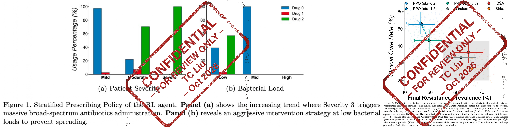
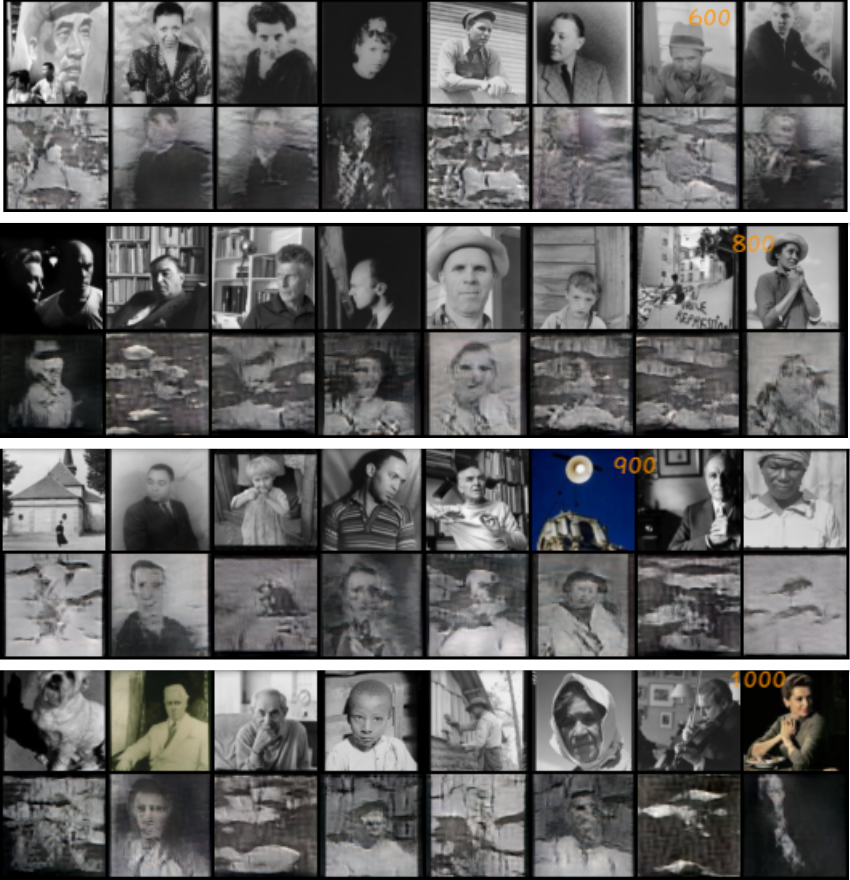

# Te-Chun Liu — PhD Application Supplement

I study multi-agent reinforcement learning (MARL) and sequential decision-making for autonomous agents operating in structured, dynamic environments under partial observability. My current research uses spatial and domain-specific simulations to investigate decentralized behavior and delayed system-level consequences. My long-term goal is to develop methods that combine MARL with structured world models, enabling agents to coordinate under uncertainty, accommodate heterogeneous objectives, and reason about the long-term consequences of their actions.

## Contents

- [Research Experience](#research-experience)
- [Selected Projects](#selected-projects)
- [Publications](#publications)
- [Applied Research & Data Science](#applied-research--data-science)
- [Education & Background](#education--background)
- [Contact](#contact)
- [References](#references)

---

## Research Experience

### Spatial Multi-Agent Reinforcement Learning for Epidemic Control with Heterogeneous Risk Preferences
*Artificial Intelligence in Medicine (Accepted, October 2026)*

[Code Repository](https://github.com/dukee1213/SpatialRL.git) · [Manuscript (Available upon Request)](mailto:b07801013@ntu.edu.tw)

Investigates decentralized intervention policies in a continuous 2D spatial transmission environment, using MADDPG with heterogeneous utility-transformed rewards and a representative-agent training paradigm that reduces training overhead by approximately 99%. The results show that decentralized policies respond differently to heterogeneous behavioral preferences and that system performance is sensitive to the representation of local information and agent incentives.

**Key methods:** Multi-Agent Reinforcement Learning (MARL) · Centralized Training with Decentralized Execution (CTDE) · MADDPG · Spatial Simulation · Scalable Agent Training

---

### Reinforcement Learning Reveals Emergent Antibiotic Stewardship Strategies in a Virtual Hospital Ward
*Manuscript status: Submitted to Computers in Biology and Medicine*

[Selected Experimental Results](fig/amr.jpg) · [Manuscript (Available upon Request)](mailto:b07801013@ntu.edu.tw)

Examines multi-scale decision-making in hospital wards by coupling within-host bacterial competition differential equations with 2D spatial transmission to optimize dynamic drug prescribing under delayed resistance emergence. Deploys PPO with a multi-objective reward to derive treatment policies that balance immediate infection cure against long-term ecological resistance.

**Key methods:** Reinforcement Learning · Proximal Policy Optimization (PPO) · Multi-Scale Simulation (ODE + Spatial ABM) · Multi-Objective Optimization · Clinical Decision-Making

---

### Composition-Aware Portrait Optimization via Explicit Geometric Constraints
*Master's Thesis Project · CVIT 2026 (Proceedings of SPIE)*

[Paper (PDF)](https://www.dropbox.com/scl/fi/v2nxqbtlb8ep10lxtvdel/Aesthetics_v3.pdf?rlkey=tel0on2vn62vk2xk8s8tuw1p2&st=ommciisj&dl=0) · [DOI](https://doi.org/10.1117/12.3123776) · Code and app: planned GitHub release in late 2026.

Formulates portrait framing as an energy minimization problem over explicit geometric constraints (vanishing points, gaze vectors, and visual mass balance) rather than opaque latent-space manipulation. Demonstrates that combining geometric heuristics with gradient search and tree-based ranking achieves controllable composition on resource-constrained hardware.

**Key methods:** Computer Vision · Computational Photography · Geometric Constraints · Energy Minimization · Controllable Optimization

---

## Selected Projects

### Autonomous Framing Agent with Unity ML-Agents
[Demo Video](https://www.dropbox.com/scl/fi/frpsduiwl9ujcwpv37743/Single-Agent-RL-for-aesthetic-photo.mp4?rlkey=5h1aa9rtd84yov655ab6h8vz2&st=u8zh0pym&dl=0) · [Course Report (PDF)](https://www.dropbox.com/scl/fi/h12v94zb9j9tppmn0fz51/Portrait-Aesthetics.pdf?rlkey=awxkkn9z14pr8eoyq34ov6utd&st=7kwt45rn&dl=0)

Developed as an exploratory course project preceding the CAPO framework, this system trains an autonomous camera agent in Unity to discover aesthetically composed viewpoints using reinforcement learning. The agent observes relative 3D spatial coordinates across scenes (restaurant environment showcased out of three assets) and optimizes its trajectory using reward signals from an external aesthetic evaluator. An episode ends when the camera moves beyond a preset distance from the subject. I also fully implemented the Unity-based multi-agent reinforcement learning football-game tutorial from Hugging Face's [Deep RL Course](https://huggingface.co/learn/deep-rl-course/en/unit7/hands-on?utm_source=chatgpt.com), with the complete learning notes for the tutorial series available upon request from the author.

- **Pipeline Architecture:** Environment logic exported from Unity; ML-Agents policy training executed in WSL with rendering enabled (`--no-graphics` disabled) alongside a parallel WSL instance hosting a pretrained aesthetic evaluator in FastAPI to stream inference rewards.
- **Key methods:** Reinforcement Learning · Unity ML-Agents · FastAPI Backend · PPO · External Aesthetic Evaluation via FastAPI

---

### Multi-User VR Interactive Physics Simulation (Curling)
[Prototype Code](https://github.com/chengpong1127/CurlingPrototype.git) · [Proposal (PDF)](https://www.dropbox.com/scl/fi/zncvyvoy0lzzu1vuzyksy/Curl-Clash-Proposal.pdf?rlkey=vhjgdlvif24pzdb6hogbliqlv&st=0te8z2a9&dl=0) · Demos: [Gameplay I](https://www.dropbox.com/scl/fi/b252q76nct37clqe8xvkw/VR-Game-I.mp4?rlkey=k6c4eyy626qhpde9m1bu9ys9a&st=kvbmxb3o&dl=0) · [Gameplay II (Tutorial Mode)](https://www.dropbox.com/scl/fi/umv8jhh12kwkzz9nzuhrc/VR-Game-II.mp4?rlkey=ndp3wmpm3mzuummcw4tu23obw&st=8mhj3a28&dl=0) · [Motion Capture](https://www.dropbox.com/scl/fi/c8cm50zh2hoi8kw5fzc7g/VR-Game-III.mov?rlkey=0gyqk6k5hqhkvoip7b38giwu4&st=xyfl368r&dl=0)

Developed as a five-person collaborative VR course project, this system implements an interactive 3D physics-based curling simulation supporting real-time interactions across distinct hardware devices. The engine couples custom friction and kinetic collision mechanics with motion-tracked sweeping across Meta Quest 2 and HTC Vive headsets using OpenXR.

- **Key methods:** Virtual Reality · Multi-User Networking · Interactive Physics Simulation · OpenXR · Motion Tracking

---

### Automated Optical Inspection Prototype for Coin Surface Defects
[Code](https://github.com/goldensolerie/coin.git) · Demos: [System Demo I](https://www.dropbox.com/scl/fi/tll9qzg1g7gg09ymws0nb/Coin-I.mp4?rlkey=5jzz9bn7vn6n7cokcexlimojz&st=6v3m9s9e&dl=0) · [System Demo II](https://www.dropbox.com/scl/fi/zpn1w988bfi9ixl8jlj0y/Coin-II.mp4?rlkey=pwd2se575y8ahhn4jczsquwt9&st=nk1sh72h&dl=0) · Slides: [Technical Overview (ZH)](https://www.dropbox.com/scl/fi/b1nschmolcsi5mx2a6hu2/20240731_.pdf?rlkey=8i3blm9eeudemv4ugb0k6a2w1&st=6ywba8d9&dl=0) · [Hardware Design (ZH)](https://www.dropbox.com/scl/fi/hnoantcbgwc826pl3fnu8/0331.pdf?rlkey=ezef7wht89mxe925jiyb206m9&st=nafg7wdv&dl=0)

Developed in collaboration with a precision coin manufacturer in New Taipei City, this project built an end-to-end Automated Optical Inspection (AOI) prototype to solve an industrial defect detection bottleneck. To automate sample throughput, I coordinated a multi-device hardware pipeline synchronizing an Arduino microcontroller driving a motorized linear track with an Android camera acquisition unit. The primary operational challenge was inspecting two distinct defect categories—fine structural scratches and surface oxidation—which required conflicting lighting conditions, forcing us to engineer a dual-stage setup combining ambient illumination with an isolated dark-box inspection chamber. Across this pipeline, I evaluated traditional OpenCV methods (SIFT feature matching, affine spatial alignment, contour extraction, and morphological filtering) against deep learning classification to determine practical trade-offs between inference latency, illumination robustness, and defect detection accuracy.

- **Key methods:** Edge AI · Embedded Systems · ONNX Runtime · OpenCV · Hardware-Software Co-Design

---

## Publications

### Accepted Publications

- **Liu, Te-Chun**, Lee, Hsuan-Wei.  
  *Spatial Multi-Agent Reinforcement Learning for Epidemic Control with Heterogeneous Risk Preferences.*  
  *Artificial Intelligence in Medicine* (Accepted, October 2026; Ms. Ref. No. AIIM-D-26-00520R2).  
  [Code Repository](https://github.com/dukee1213/SpatialRL.git) · [Manuscript (Available upon Request)](mailto:b07801013@ntu.edu.tw)

### Published Proceedings

- **Liu, Te-Chun**, Yang, Chuan-Kai, Lai, Yung-Chuan.  
  *Composition-Aware Portrait Optimization via Explicit Geometric Constraints.*  
  *Proceedings of the Seventh International Conference on Computer Vision and Information Technology (CVIT 2026)*, Proc. SPIE, Vol. 14321, pp. 45–52, 2026. 
  [Paper (PDF)](https://www.dropbox.com/scl/fi/v2nxqbtlb8ep10lxtvdel/Aesthetics_v3.pdf?rlkey=tel0on2vn62vk2xk8s8tuw1p2&st=ommciisj&dl=0) · [DOI: 10.1117/12.3123776](https://doi.org/10.1117/12.3123776)

### Submitted / Under Review

- Lee, Hsuan-Wei, **Liu, Te-Chun**.  
  *Reinforcement Learning Reveals Emergent Antibiotic Stewardship Strategies in a Virtual Hospital Ward*  
  Target venue: *Computers in Biology and Medicine*   
  [Selected Experimental Results](fig/amr.jpg) · [Draft (Available upon Request)](mailto:b07801013@ntu.edu.tw)

---

## Applied Research & Data Science

### Multi-Class Latent Attribute Disentanglement in Generative Models (StylEx)
[Extended Visualizations](https://www.dropbox.com/scl/fi/fj5vigfb94fyzzzhx6s5r/stylex_b.png?rlkey=saflplwsy39ig50rfpm64d74b&st=y70z2icj&dl=0) · Code available upon request

I implemented the multi-class application explicitly proposed in the original paper's Future Work section, adapted a StylEx-based StyleSpace attribute-search pipeline from a binary-classification setup to a 20+ class photographer-identification task, and re-engineered an open-source implementation ([Explaining-In-Style-Reproducibility-Study](https://github.com/NoahVl/Explaining-In-Style-Reproducibility-Study.git)) [1] using the portrait-authorship dataset [2]. This two-month project investigated whether photographer-specific visual patterns could be isolated through counterfactual latent manipulation. The resulting visualizations revealed substantial entanglement among photographic attributes in the limited, stylistically diverse dataset, demonstrating the limitations of unconstrained latent steering and motivating my subsequent work on explicit geometric constraints in CAPO. The project was ultimately halted due to GPU memory constraints.

- **Key methods:** Explainable AI (XAI) · StyleGAN2 Inversion · Latent Disentanglement · StyleSpace Attribute Search · Counterfactual Generation

*Figure: Multi-class StylEx training progression across portrait batches. In each block, the top row shows ground truth portraits and the bottom row shows GAN-generated inversions. Photographer classes are organized by column. Orange numerical overlays indicate training iterations.*

---

### Longitudinal EHR Imputation & Missing-Data Modeling (NTU School of Pharmacy)
[Unpublished Report (PDF)](https://www.dropbox.com/scl/fi/u5ayjg5mzktsvik63vtde/.pdf?rlkey=bhu3jyhlg82pvsoh9vjmz3sus&st=wnyrzm2b&dl=0) · [Conference Poster (PDF)](https://www.dropbox.com/scl/fi/zn10wpg3svb0tju1kyh0j/.pdf?rlkey=h1rliplh0wtsxe6yb66antxkn&st=p64ueeno&dl=0) · [Lab Profile](https://scholars.lib.ntu.edu.tw/entities/person/772b19b0-b0f1-4c8d-a230-4d72650ed547)

Working for one year as a Research Assistant under Prof. Wang at the National Taiwan University School of Pharmacy, I diagnosed missing-data mechanisms (MAR vs. MNAR) across 17 relational tables in the NTUH-IMD database for a cohort of 7,020 diabetic patients. Using multivariable logistic regression and neural networks across 30- and 90-day pre-index windows, I established that missing laboratory measurements followed an ignorable MAR pattern driven by chronic refill frequency rather than latent clinical severity. I then benchmarked parametric MICE against non-parametric machine learning models via 10-fold cross-validation with artificial feature masking, establishing `MissForest` as the optimal strategy for recovering continuous laboratory trajectories (HbA1c and serum creatinine).

- **Key methods:** Pharmacoepidemiology · Missing-Data Diagnostics (MAR/MNAR) · MissForest Imputation · Relational EHR Curation · Longitudinal Modeling

---

### Dynamic Panel Econometrics & Trade-Mediated Decarbonization (CIER)
[Unpublished Report (PDF)](https://www.dropbox.com/scl/fi/cqtrm2d2quagxa93ukxrf/.pdf?rlkey=q67ag6i2eir6relm734ifg3h1&st=k94v3uep&dl=0)

During a one-year internship at the Center for Green Economy, Chung-Hua Institution for Economic Research (CIER), I modeled the trade-mediated decarbonization channel under the EU Carbon Border Adjustment Mechanism (CBAM). Analyzing a panel of 113 economies from 2001 to 2019 using WTO HS-6 product-level trade flows and EDGAR emission metrics, I deployed two-way fixed effects and dynamic panel System GMM to disentangle tariff elasticities from macroeconomic scale effects. The empirical design identified clear intertemporal policy transmission lags, demonstrating a 1-year lag for tariff cuts to stimulate green technology imports followed by a 2- to 3-year lag to produce statistically significant domestic $\text{CO}_2$ mitigation.

- **Key methods:** Dynamic Panel Econometrics · System GMM · Causal Identification · Two-Way Fixed Effects · Policy Impact Evaluation

---

### Research Appointments & Industry Data Analytics Practice
- From August 2024 to present, I serve as a Research Assistant for Dr. Hsuan-Wei "Wayne" Lee across the Institute of Sociology, Academia Sinica and Lehigh University, co-developing spatial multi-agent reinforcement learning architectures for dynamic epidemiological systems.
- My earlier industry analytical practice includes eight months as a full-time Data Analyst at the Taiwan Food and Drug Administration (FDA) building automated SQL, Python, R, and Tableau surveillance pipelines for import and domestic safety inspections (e.g., condiment and seasoning compliance), alongside a five-month data analyst internship at Perfect Corp modeling mobile app user retention via Lasso feature selection and logistic regression ([Project Slides](https://www.dropbox.com/scl/fi/5950lbyqemeygprwwta10/.pdf?rlkey=n2dnvb5h6citi70lk52jg8rf3&st=40e3wbyn&dl=0)).

---

## Education & Background

**National Taiwan University of Science and Technology (Taiwan Tech)**  
M.S. in Information Management  
- Research focus: Multi-Agent Reinforcement Learning and Geometric Computer Vision
- Relevant coursework: Distributed ML Systems, ML & Big Data Analytics, AI & Deep Learning, LLMs & Information Security

**National Taiwan University (NTU)**  
B.S. in Public Health & B.A. in Economics (Double Major), Minor in Business Analytics
- Core focus: Biostatistics, Computational Epidemiology, Econometric Identification, Mathematical Optimization

**Honors & Fellowships**
- Taiwan Ministry of Education (MOE) Government Scholarship for Overseas Study — AI Track, 114th Batch
- National Taiwan University Academic Achievement Award (Top 5%, 2019)

> **Transcripts** are available upon [request](mailto:b07801013@ntu.edu.tw).

---

## Contact

**Te-Chun Liu**  
[Email](mailto:b07801013@ntu.edu.tw) · [Google Scholar (TC Liu)](https://scholar.google.com) · [LinkedIn](https://www.linkedin.com/in/duke-liu-747a482b9)

---

## References

[1] Lang, O., Gandelsman, Y., Yarom, M., Wald, Y., Elidan, G., Hassidim, A., Freeman, W. T., Isola, P., Globerson, A., Irani, M., & Mosseri, I. (2021). Explaining in Style: Training a GAN to Explain a Classifier in StyleSpace. In Proceedings of the IEEE/CVF International Conference on Computer Vision (ICCV) (pp. 693–702).

[2] Thomas, C., & Kovashka, A. (2016). Seeing Behind the Camera: Identifying the Authorship of a Photograph. In *Proceedings of the IEEE Conference on Computer Vision and Pattern Recognition (CVPR)* (pp. 3494–3502).